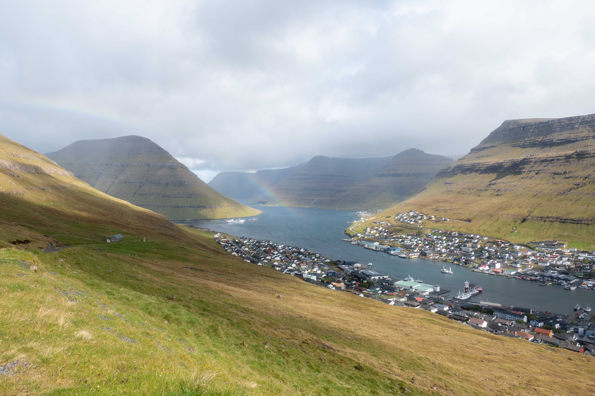
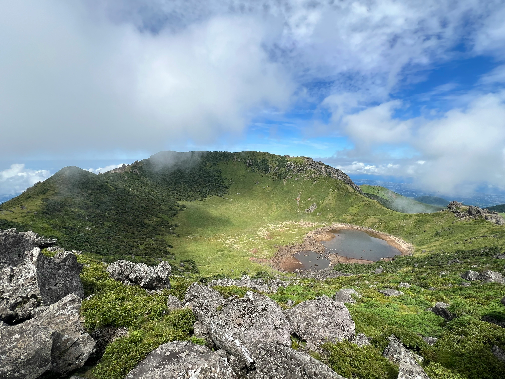

Q: 
Where is this located?
A: The Faroe Islands

C: The Faroe Islands are part of [the Kingdom of Denmark].

Q: 
What is the name of this lake?
A: Baengnokdam

Q: What is the name of the volcano comprising much of Jeju Island?
A: Hallasan

Q: What is the tallest mountain in South Korea?
A: Hallasan
