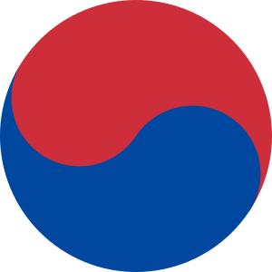

Q: University name?

A: Seoul National University

Q: University name?

A: Korea University

Q: Code for South Korean won
A: KRW

Q: What is the name of this symbol in Korean?

A: 태극
#leech #suspended

Q: What is Anywhere on Earth (AoE) timezone?
A: UTC -12

C: The ISBN stands for [International Standard Book Number].

C: [Bartolomeo Cristofori] is famous for inventing the [piano].

C: The symbol for [South Korean won] is [₩].

Q: What is the background of the "Where Is My Mind?" by Pixies?
A: The song was inspired by frontman' experiences while scuba diving in the Caribbean: a tiny fish persistently followed him underwater.
#trivia

Q: Who is the frontman of the Pixies as of 2026?
A: Black Francis

C: [Semantic satiation] is [a psychological phenomenon in which repetition causes a word or phrase to temporarily lose meaning for the listener].

Q: What is the South Korean term for an obsessive fan who invades the privacy of Korean idols, actors, etc.?
A: *Sasaeng* fan (Korean: 사생팬)

Q: What is *otaku*?
A: Someone with an obsessive, all-consuming interest in a particular hobby, most often anime, manga, or video games.

Q: In cryptography, what is PEM?
A: A file format for storing and sending cryptographic keys, certificates, etc.
#cryptography

Q: In cryptography, what PEM stands for?
A: Privacy-enhanced mail
#cryptography

C: The [Streisand effect] is the phenomenon in which [an attempt to hide, remove, or censor information results in increased public awareness of the information].

Q: What is the name of the shinbone?
A: The tibia
#anatomy

Q: What is the half-life of caffeine?
A: About 5 hours.

Q: What's the rule of thumb borderline for caffeine at bedtime?
A: 30–35 mg

Q: How much caffeine is in a cup of black tea as a rule of thumb?
A: About 50 mg (40–70 mg)

C: YIMBY is an acronym for the phrase ["yes in my back yard"].
