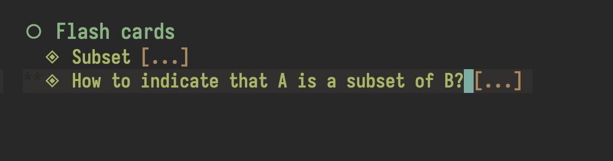
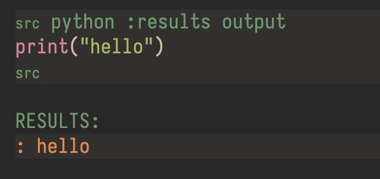

Q: How to preview LaTeX?
A: `⌃+C` + `⌃+X` + `⌃+L`
#emacs

Q: How to insert an external link in Emacs?
A: `⌃+C` + `⌃+l`
#emacs

Q: How do I insert a node link in Emacs?
A: `SPC` + `n` + `r` + `i`
#emacs #suspended

Q: How do I insert a citation in org mode?
A: `SPC` + `M` + `@`
#emacs #suspended

Q: How do I insert a citation **with citation style selection** in org mode?
A: `SPC` + `u` + `SPC` + `M` + `@`
#emacs #suspended

Q: How to change the TODO state of an item in Emacs?
A: `SPC` + `M` + `T` + `"state"`
#emacs #suspended

Q: How to insert a deadline timestamp in Org Mode?
A: `SPC` + `M` + `D` + `D`
mnemonic: **m**ake **d**ate **d**eadline
#emacs #org-mode

Q: How to find the keyboard shortcut for a specific command in Emacs?
A: `⌃+H` + `W` + `Command Name`
#emacs

Q: How to open the agenda for current week or day in Emacs?
A: `SPC` + `o` + `A`
#emacs #suspended

Q: How to change the priority of an item in Org Mode?
A: `SPC` + `m` + `p` + `p`
#emacs #org-mode #suspended

Q: How to find what command is used by specific keyboard shortcut in Emacs?
A: `⌃+H` + `K` + `Command Name`
#emacs

Q: How to cancel the current key sequence in Emacs?
A: `ESC` + `ESC` + `ESC`
or
`⌃+G`
#emacs

Q: How to go to the beginning of the buffer in Emacs?
A: `Meta` + `<`
#emacs #suspended

Q: How to interactively replace the text in Emacs?
A: `Meta` + `%`
#emacs #suspended

Q: 
How to change the level of the current heading?
A: M-Left Arrow or M-Right Arrow
#emacs

Q: How to toggle the checkbox in Org Mode?
A: `SPC` + `M` + `X`
#emacs #org-mode #suspended

Q: 
How to run the code in Org Mode?
A: `⌃+C` + `⌃+C`
#emacs

Q: How to clock in in Org Agenda?
A: `I`
#emacs #org-mode #suspended

Q: How to cancel the running clock in Org Agenda?
A: `X`
#emacs #suspended

Q: How to jump to the currently clocked task in Org Agenda?
A: `J`
#emacs #org-mode #suspended

Q: How to resume the most recent task in org-pomodoro?
A: C-u C-u M-x org-pomodoro
#emacs #suspended

Q: How to refile the entry to another heading in Org Mode?
A: `SPC` + `M` + `S` + `R`
mnemonic: **m**ake **s**ubtree **r**efile
#emacs #org-mode #suspended

Q: How to set the tags in Org Mode?
A: `SPC` + `M` + `Q`
#emacs #org-mode #suspended

Q: Suppose you have a weekly task scheduled for Monday, September 21 (2026-09-21), that you finally complete on Wednesday, October 7 (2026-10-07). Also closest Monday is October 12 (2026-10-12).
SCHEDULED: <2026-09-21 Mon +1w>
Where this date would move after being marked DONE?
A: <2026-09-28 Mon +1w>
Accumulated.
#emacs #org-mode

Q: Suppose you have a weekly task scheduled for Monday, September 21 (2026-09-21), that you finally complete on Wednesday, October 7 (2026-10-07). Also closest Monday is October 12 (2026-10-12).
SCHEDULED: <2026-09-21 Mon ++1w>
Where this date would move after being marked DONE?
A: <2026-10-12 Mon ++1w>
Next Monday.
#emacs #org-mode

Q: Suppose you have a weekly task scheduled for Monday, September 21 (2026-09-21), that you finally complete on Wednesday, October 7 (2026-10-07). Also closest Monday is October 12 (2026-10-12).
SCHEDULED: <2026-09-21 Mon .+1w>
Where this date would move after being marked DONE?
A: <2026-10-14 Wed .+1w>
Exactly 1 week from now.
#emacs #org-mode

Q: What is Emacs an acronym for?
A: Editor Macros
#emacs
